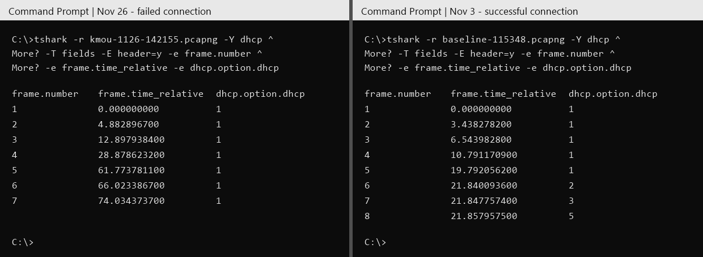

# KMOU-WLAN Connected but No Internet | Korea Maritime & Ocean University Wi-Fi

[한국어](README.md) · [Troubleshooting write-up template](TEMPLATE.md)

A Windows laptop connected to Korea Maritime & Ocean University (KMOU) Wi-Fi but could not reach the internet. The network was KMOU-WLAN, and the laptop showed a 169.254.x.x address after failing to obtain one through DHCP. A similar symptom was reported on another laptop. Across three access points, **the affected laptop sent 15 DHCP Discover packets and received no Offers**. Later that afternoon, it reconnected to the original access point, received an address, and passed an internet connectivity check.

## Connection and address assignment

Windows logs showed successful 802.1X authentication. The `ipconfig` output showed an address in `169.254.0.0/16` and no IPv4 default gateway. Windows had assigned itself a link-local address after failing to obtain one through DHCP. The laptop had no default IPv4 route to the internet.

The same laptop received a usable address on a phone hotspot and passed a web check. Two additional access points broadcasting the campus network were then tested. Authentication succeeded on each of the three access points, but no Offer reached the laptop. This made a fault confined to one access point less likely. The client records could not determine where the request or reply stopped.

## Timeline and observations

All times are Korea Standard Time (UTC+9). The table covers the test windows. The number of users affected and the duration across campus were not measured.

| When | Test | Observation |
| --- | --- | --- |
| Nov 3, 2026 | Campus Wi-Fi connection and IP retry | The first captured Discover preceded the first Offer by 21.84 seconds. A later transaction in that capture completed as Discover → Offer → Request → ACK. |
| Nov 26, 14:22–14:29 | Same campus network across three access points | Authentication succeeded on all three. The capture showed 7, 4, and 4 Discovers, with zero Offers during the test windows. |
| After the failure tests | Phone hotspot on the same laptop | DHCP replied, Windows obtained a usable address, and the web check passed. |
| Nov 26, 14:42 | Reconnect to the original campus access point | Authentication succeeded at 14:42:53.909. Windows recorded a lease obtained at 14:42:58. A subsequent HTTPS check returned 204 over the campus connection. |

*Figure 1. Actual packet fields exported with TShark and rendered in a Command Prompt style. Each panel starts its elapsed time at the first packet. The failed panel shows the first access point. The successful panel is from November 3.*

**21.84 seconds elapsed from the first Discover in the right-hand capture (frame 1, 0.000 s) to the first Offer (frame 6, 21.840 s).** Frames 1 and 6 have different DHCP transaction IDs. The first Discover with the Offer's transaction ID is frame 3 (6.544 s), so the gap within that exchange is about **15.30 seconds**. Both intervals come from the laptop's capture. Measuring how long the server took to handle the request would require a server-side record.

*Figure 2. The November 26 recovery occurred after packet capture ended. The ipconfig excerpt shows the recorded lease with the IP address, default gateway, and DHCP server address redacted. The authentication timestamp in the table came from Windows WLAN AutoConfig.*

## DHCP lease duration hypothesis

One hypothesis was that overlapping lease renewals were delaying address assignment. The laptop obtained a 24-hour lease on November 3 and a 10-hour lease after recovery on November 26. These were two successful connections on different days. Lease activity during the failure was not measured, and these observations do not establish a change in campus lease policy.

With many connected clients, shorter leases can increase the number of renewals. A connected device can normally request renewal before expiration and keep the same address if the server approves it. **The observed 10-hour lease alone does not establish server load or address exhaustion.** [RFC 2131 §4.4.5](https://datatracker.ietf.org/doc/html/rfc2131#section-4.4.5)

To evaluate the hypothesis, check **free addresses in the pool**, **Discover-to-Offer latency**, and **request volume, queue depth, and packet drops** during a failure. Compare the same requests at the laptop, the AP uplink or DHCP relay, and the server. These observations would help distinguish address exhaustion, processing delays, and a forwarding problem. [Microsoft's DHCP troubleshooting guidance](https://learn.microsoft.com/en-us/troubleshoot/windows-server/networking/troubleshoot-dhcp-guidance)

## Procedure if the issue recurs

1. **Check the SSID, connection state, IPv4 address, and default gateway.** Record the time and time zone.
2. **Start a short packet capture on the affected laptop before reconnecting.** Apply the `dhcp` display filter in Wireshark and identify the last observed step. Test the same laptop on a phone hotspot for comparison.
3. **Verify recovery with a web request.** Record the recovery time separately from any proposed cause. An IP retry coincided with a successful exchange on November 3. A retry on November 26 still produced no Offer. The connection recovered on a later reconnect, and the trigger was not determined.
4. **Give the network team both the failure and success timestamps.** Use them to correlate client, access point, and DHCP server records.

Read-only Windows checks used during diagnosis:

~~~cmd
netsh wlan show interfaces
ipconfig /all
~~~

To read relative time, transaction ID, and DHCP message type from a saved capture:

~~~powershell
tshark -r capture.pcapng -Y dhcp -T fields -e frame.time_relative -e dhcp.id -e dhcp.option.dhcp
~~~

DHCP message types 1, 2, 3, and 5 are Discover, Offer, Request, and ACK. The public figures contain only the fields used for comparison.

## Writing references

- [Google SRE's example postmortem](https://sre.google/sre-book/example-postmortem/) informed the structure for impact, timeline, and follow-up.
- [Cloudflare's July 17, 2020 outage report](https://blog.cloudflare.com/cloudflare-outage-on-july-17-2020/) informed the use of timestamped evidence and specific follow-up checks.
- [Julia Evans's DNS troubleshooting write-up](https://jvns.ca/blog/2021/11/04/how-do-you-tell-if-a-problem-is-caused-by-dns/) informed the use of small tests to check one stage at a time.
