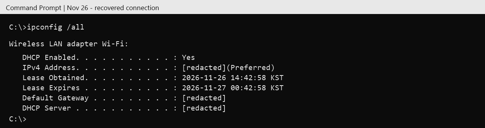

# KMOU-WLAN Connected but No Internet | Korea Maritime & Ocean University Wi-Fi

[한국어](README.md)

The laptop signed in to KMOU-WLAN, but websites wouldn’t load. It was still waiting for an IPv4 address from the campus network. **Once the network assigned an address, web access returned.**

## Check for the same symptom on Windows

1. Connect to KMOU-WLAN, search for `cmd` in the Start menu, and run `ipconfig` in Command Prompt.
2. Under **Wireless LAN adapter Wi-Fi**, look for `IPv4 Address` (or `Autoconfiguration IPv4 Address`) and `Default Gateway`.

On this laptop, **the IPv4 address started with `169.254.` and the default gateway was blank.** Windows had assigned itself a temporary address after it failed to get one from the campus network. If you see both signs, try opening a website on the same laptop using a phone hotspot. Then reconnect to campus Wi-Fi, run `ipconfig` again, and see whether a gateway appears and the same page loads.

If your IPv4 address starts with something other than `169.254.` and a default gateway is listed, your laptop shows a different symptom. If sign-in itself fails, the university IT site has setup instructions under **학내 무선네트워크** (campus Wi-Fi). [KMOU Wi-Fi setup](https://www.kmou.ac.kr/cisc/main.do)

## What happened before and after the laptop got an address

**November 3, 2026.** The DHCP capture shows the laptop making several attempts to get an address (`Discover`). The campus network offered one (`Offer`), the laptop asked to use it (`Request`), and the network approved it (`ACK`).

*In the right panel, **21.84 seconds** elapsed between the first Discover the laptop captured (frame 1, 0.000 s) and the first Offer (frame 6, 21.840 s). Those packets have different transaction IDs. The first Discover with the same ID as the Offer was frame 3 (6.544 s), giving an interval of **15.30 seconds**. Both intervals were measured at the laptop.*

**November 26, 2026.** Between 14:22 and 14:29 Korea Standard Time, the laptop signed in successfully at three campus access points. It sent 15 Discovers in total and received no Offers while connected to campus Wi-Fi. The same laptop could load websites on a phone hotspot.

Later, the laptop reconnected to the original access point. **It obtained a campus IP address at 14:42:58 and could reach the web again.** Packet capture had already ended, so the time comes from the Windows lease record. The records do not show why the earlier attempts went unanswered.

*The address had a ten-hour lease, as shown in `ipconfig /all`. Windows normally requests a renewal before the lease expires.* [DHCP lease renewal](https://datatracker.ietf.org/doc/html/rfc2131#section-4.4.5)
