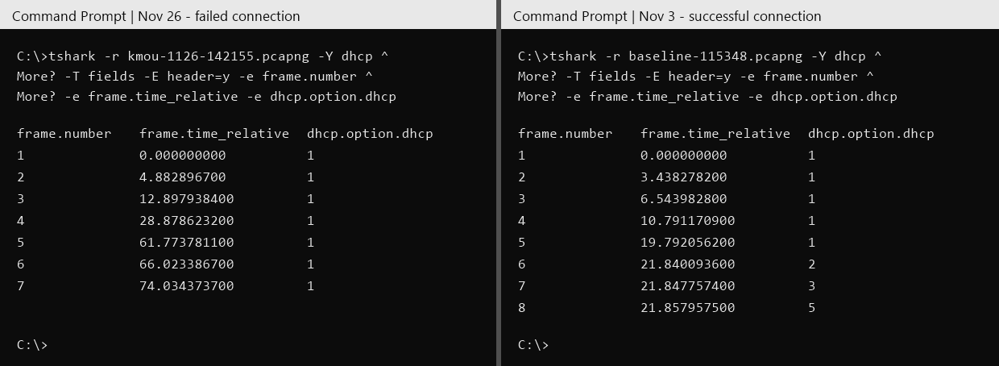
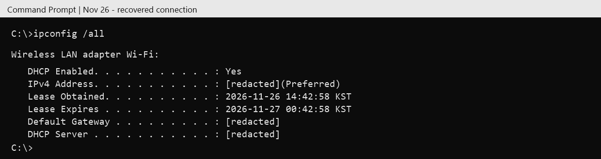

# 한국해양대 와이파이 연결됐는데 인터넷 안 될 때 (KMOU-WLAN)

[English](README.en.md)

**KMOU-WLAN 로그인은 성공했지만 노트북이 학교에서 IPv4 주소를 받지 못했습니다. 이후 학교 네트워크에서 주소를 배정받자 인터넷을 다시 사용할 수 있었습니다.** 11월 3일에는 노트북이 주소를 여러 번 요청한 뒤 학교 쪽에서 주소를 제안하고 최종 승인하는 과정까지 패킷에 기록됐습니다. 앞선 요청에 왜 응답이 도착하지 않았는지는 노트북 기록만으로 알 수 없었습니다.

## 내 노트북도 같은 증상인지 확인하는 법

학교 와이파이에 연결한 상태에서 다음 순서로 확인할 것.

1. Windows 시작 메뉴에서 `cmd`를 검색해 **명령 프롬프트**를 열고 `ipconfig`를 입력할 것.
2. 출력에서 **무선 LAN 어댑터 Wi-Fi** 항목(이름을 바꿨다면 해당 무선 어댑터)을 찾아 `IPv4 주소`(또는 `자동 구성 IPv4 주소`)와 `기본 게이트웨이`를 확인할 것.

| 내 화면에 보이는 상태 | 다음에 할 일 |
| --- | --- |
| IPv4가 `169.254.x.x`이고 기본 게이트웨이가 비어 있음 | 이 사례에서는 Windows가 임시 주소를 스스로 붙인 상태였습니다. 같은 노트북에서 휴대폰 핫스팟으로 웹페이지가 열리는지 확인할 것. 학교 와이파이에 한 번 다시 연결한 뒤 `ipconfig`와 웹 접속 결과를 비교할 것. |
| IPv4가 `169.254.x.x` 대역 밖이고 기본 게이트웨이에도 IPv4 주소가 있음 | 이 사례의 실패 당시와 결과가 다릅니다. 여러 웹사이트를 열어 모두 실패하는지, 특정 사이트에서만 문제가 생기는지 확인할 것. |
| 학교 와이파이 로그인부터 실패함 | 정보전산원 홈페이지의 **스마트캠퍼스 안내 → 학내 무선네트워크**에서 접속 방법을 확인할 것. [국립한국해양대학교 정보전산원](https://www.kmou.ac.kr/cisc/main.do) |

## 학교 네트워크가 응답했을 때의 기록

**2026년 11월 3일.** 노트북이 사용할 주소를 찾는 메시지(`Discover`)를 여러 번 보냈습니다. 학교 네트워크가 주소를 제안하자(`Offer`), 노트북이 그 주소를 요청했고(`Request`), 학교 쪽이 승인했습니다(`ACK`). 이 과정이 DHCP를 통한 IP 주소 배정입니다.

*그림 1. 오른쪽의 **21.84초**는 노트북이 기록한 첫 Discover(프레임 1, 0.000초)부터 첫 Offer(프레임 6, 21.840초)까지입니다. 두 프레임의 거래 ID는 다릅니다. 이 Offer와 거래 ID가 같은 첫 Discover(프레임 3, 6.544초)부터 재면 **15.30초**입니다. 서버 자체의 처리 시간을 알려면 서버 쪽 기록이 필요합니다.*

**2026년 11월 26일(한국시간).** 14:22~14:29에 학교 접속점 세 곳에서 인증에 성공했습니다. 학교 와이파이에 연결된 구간에서 노트북이 보낸 Discover는 총 15건이었고, 노트북에 도착한 Offer는 0건이었습니다. 같은 노트북은 휴대폰 핫스팟에서 주소를 받고 웹에 접속했습니다.

이후 처음 실패했던 접속점에 다시 연결했습니다. Windows에는 **14:42:53.909에 인증 성공, 14:42:58에 IP 임대 시작**이 기록됐습니다. 학교 와이파이로 보낸 웹 요청도 성공했습니다(HTTPS 204). 이날 복구 순간에는 패킷 캡처가 끝난 상태였습니다.

*그림 2. `ipconfig /all`에서 확인한 10시간짜리 임대입니다. IP 주소, 기본 게이트웨이, DHCP 서버 주소는 가렸습니다. 기기는 보통 임대 만료 전에 갱신을 시도합니다. 학교 장비가 과부하였는지, 배정할 주소가 부족했는지는 이 임대 시간만으로 판단할 수 없습니다.* [DHCP 임대 갱신 규격](https://datatracker.ietf.org/doc/html/rfc2131#section-4.4.5)

글 구성에 참고한 자료

[Google SRE 장애 회고 예시](https://sre.google/sre-book/example-postmortem/) · [Cloudflare 장애 보고서](https://blog.cloudflare.com/cloudflare-outage-on-july-17-2020/) · [Julia Evans의 네트워크 진단 사례](https://jvns.ca/blog/2021/11/04/how-do-you-tell-if-a-problem-is-caused-by-dns/)

